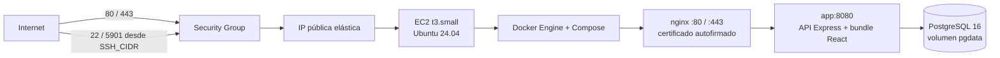
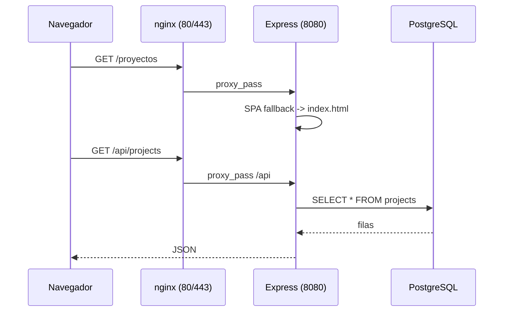
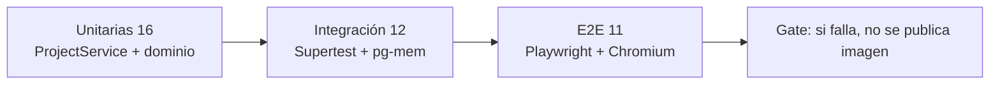

# Arquitectura del MVP y del pipeline

## 1. Vista general

```mermaid
flowchart TB
    subgraph DEV["Rama dev"]
        P1[push / PR a dev] --> T1[dev_tests]
        T1 --> T2[npm ci + build / type-check]
        T2 --> T3[16 tests unitarios]
        T2 --> T4[12 tests de integración]
        T2 --> T5[11 tests E2E Playwright]
        T3 --> R[Artifact: reportes]
        T4 --> R
        T5 --> R
    end

    subgraph MAIN["Rama main - 10 pasos"]
        P2[push a main] --> Q[1 quality gate]
        Q --> B[2 build Docker Buildx]
        B --> U[3 push Docker Hub]
        U --> I[4 terraform init + validate]
        I --> PL[5 terraform plan]
        PL --> AP[6 terraform apply]
        AP --> CP[7 scp setup_vm.sh]
        CP --> CF[8 configurar VM: Docker, Git, UFW, iptables, VNC]
        CF --> DP[9 scp compose + deploy_vm.sh]
        DP --> SM[10 smoke test 80 / 443]
    end
```

## 2. Topología en AWS (Terraform)

Recursos creados por `infra/terraform/main.tf`:

| Recurso | Propósito |
| --- | --- |
| `aws_vpc` | Red aislada `10.20.0.0/16` |
| `aws_subnet.public` | Subred pública con IP automática |
| `aws_subnet.private` | Subred privada (preparada para BD/servicios internos) |
| `aws_internet_gateway` + route table | Salida a Internet de la subred pública |
| `aws_security_group` | 80/443 abiertos; 22/5901 restringidos por CIDR |
| `aws_key_pair` | Clave pública inyectada por secreto |
| `aws_instance` | Ubuntu 24.04 (AMI Canonical noble) |
| `aws_eip` | IP pública estable |

## 3. Flujo de una petición

La misma imagen sirve el frontend compilado y la API; por eso `docker-compose.yml`
solo necesita tres contenedores (`db`, `app`, `proxy`).

## 4. Decisiones técnicas

| Decisión | Justificación | Alternativa descartada |
| --- | --- | --- |
| Un solo workflow YAML | El enunciado pide "un pipeline .yml"; los jobs se separan por `if` de rama | Dos archivos independientes (más duplicación) |
| Express + TypeScript | Ecosistema maduro, fácil de testear con Supertest | Fastify (menos familiar para el evaluador) |
| PostgreSQL real + `pg-mem` en tests | Integración prueba SQL real sin servicio externo en CI | SQLite (diferencias de sintaxis) |
| Vitest en API, Playwright en web | Unit/integración rápidos; E2E con navegador real | Jest + Cypress (más configuración) |
| Multi-stage Dockerfile | `node_modules` de build no viajan a producción | Imagen única con devDependencies |
| nginx delante de la app | Permite publicar 80 y 443 y terminar TLS | Exponer Node directamente |
| `setup_vm.sh` como mecanismo principal | Cumple literalmente "SCRIPT.SH o ANSIBLE"; se copia por SCP | Ansible (requiere inventario y Python en la VM) |
| Terraform con estado local | Cero dependencias extra para la demo | Backend S3 (recomendado en producción, ver mejoras) |

## 5. Contrato de la API

| Método | Ruta | Respuesta |
| --- | --- | --- |
| `GET` | `/api/health` | `{ status: "ok", service, time }` |
| `GET` | `/api/developers` | Array con los 2 integrantes |
| `GET` | `/api/projects` | Array de proyectos |
| `GET` | `/api/projects/:id` | Proyecto o 404 |
| `POST` | `/api/projects` | 201 / 400 (Zod) / 409 (duplicado) |
| `DELETE` | `/api/projects/:id` | 204 o 404 |
| `POST` | `/api/contact` | 202 / 400 (Zod) |

Esquema `projects`: `id SERIAL`, `title`, `description`, `tech` (JSON en `TEXT`),
`owner`, `year`, `link`. El array `tech` se guarda como JSON para que la misma
consulta funcione en PostgreSQL y en `pg-mem`.

## 6. Estrategia de pruebas

- **Unitarias:** lógica de negocio aislada con repositorio mockeado (validación,
  duplicados, 404, normalización).
- **Integración:** app Express real + base de datos en memoria + Supertest; cubre
  rutas, códigos HTTP y persistencia.
- **E2E:** navegador real contra Vite + API con semilla; cubre navegación,
  catálogo, detalle, equipo, formulario y API.

Los E2E usan puertos dedicados (`3101` API, `5317` web) para no colisionar con
otros servicios locales y `reuseExistingServer: false` para garantizar que se
prueba **este** código.
